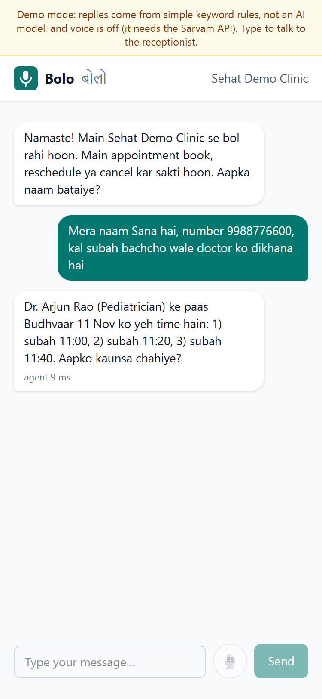
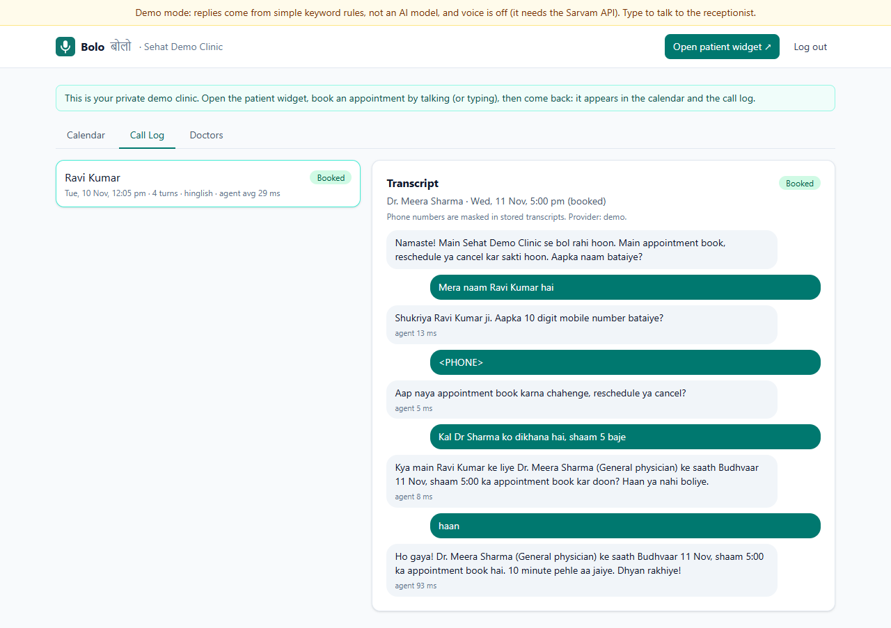
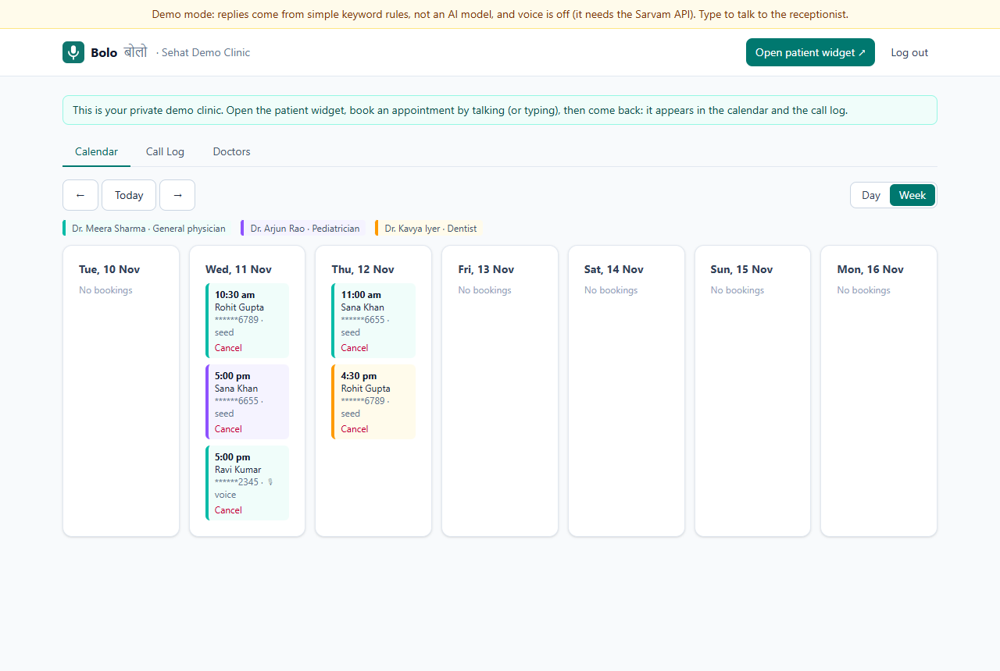
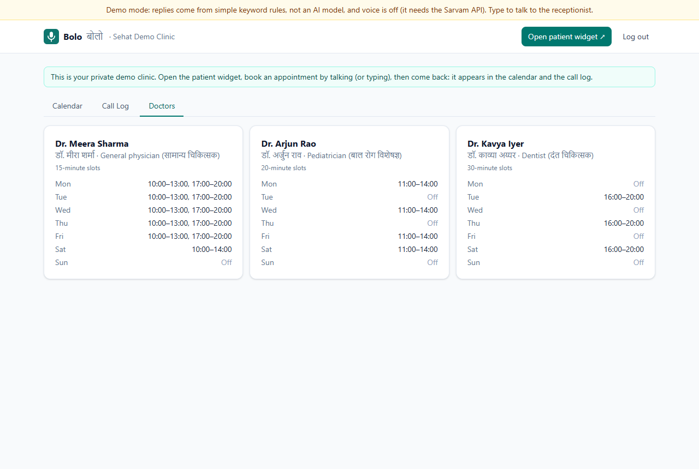
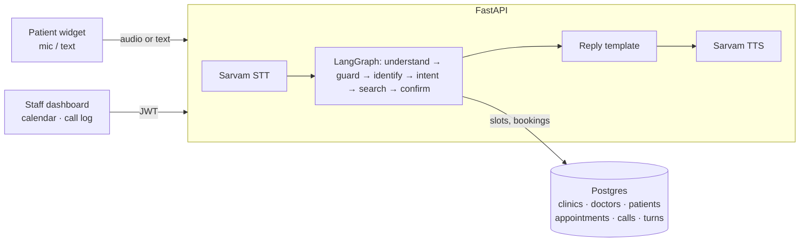

# Bolo (बोलो)

[](https://github.com/Navneet-Rishav/bolo/actions/workflows/ci.yml)

**A Hinglish voice receptionist for clinics.** Patients talk to a web widget in Hindi, English or Hinglish to **book, reschedule or cancel** appointments. Clinic staff see a calendar of bookings and every call's transcript (phone numbers masked) with per-turn latency.

> **Live demo:** https://bolo-liard.vercel.app · API: https://bolo-api.onrender.com/healthz (free tier: the first request after 15 idle minutes can take up to a minute). "Try the demo" creates your own fictional clinic with a staff dashboard and a patient-widget link.
> **The demo runs in demo mode:** a rule-based stand-in replaces the language model and voice is off (it needs the Sarvam API). The conversation state machine, slot rules, double-booking protection, masking and dashboard are the real code.

| Patient widget (phone) | Call log with masked transcript and latency |
|---|---|
|  |  |

| Calendar | Doctors and schedules |
|---|---|
|  |  |

## How a call works

1. **Voice loop:** browser mic → Sarvam speech-to-text (`saaras:v4`, code-mixed Hinglish) → agent → Sarvam text-to-speech (`bulbul:v4-flash`) → playback. Typing works too.
2. **Understand:** the language model turns the message into structured fields (intent, name, phone, doctor, date, time, option number, yes/no, emergency). Code validates each one.
3. **LangGraph state machine:** identify (name + phone) → intent → slot search → confirm → done, or handoff to staff.
4. **Business rules in code:** slots come from each doctor's weekly schedule, clinic hours, existing bookings, a 30-minute lead time and a 14-day window. **Nothing is written before an explicit "yes"** to a read-back of the booking.
5. **No double booking:** a partial unique index in Postgres rejects a second booking of the same doctor and time, even when two calls confirm at once; the losing caller is offered other times.
6. **Handoff:** emergency words → "please call 112" and a staff alert; "talk to a person" → staff; three turns without progress → staff.

## Engineering highlights

- **FastAPI + SQLAlchemy 2 + Alembic + Postgres**, JWT staff auth (bcrypt), Pydantic validation, typed JSON errors, request-ID logs, CORS limited to the frontend.
- **Multi-tenant:** every row belongs to a clinic; every staff query is scoped to it (another clinic's data is a 404). Each demo visitor gets an isolated clinic, deleted after 24 h.
- **Per-turn latency** (STT, agent, TTS) stored and shown in the widget and call log.
- **Privacy:** phone numbers (including Devanagari digits) are masked in every stored transcript; staff see `******3210`.
- **Abuse limits:** calls per IP per hour and turns per call are capped, because each turn can cost speech and model credits.
- **React + TypeScript + Tailwind + TanStack Query:** week/day calendar (IST), call log with transcripts, doctor schedules, a phone-friendly patient widget.

## Tests

- **54 backend tests** (pytest, real Postgres): phone parsing and masking, slot generation (schedule, lead time, window, time zones, booked slots), **16 scripted conversations** (English, Hinglish, Devanagari, typos, spaced digits, reschedule, cancel, decline, invalid phone, closed Sunday, emergency, human request, confusion), the **double-booking race**, clinic isolation, rate and length limits, voice routes with a fake provider, and the Sarvam client against mocked HTTP.
- **3 frontend tests** plus typecheck, lint and build; a Playwright end-to-end run (widget booking → calendar → transcript) produced the screenshots.
- The scripted conversations pass with the offline demo provider, whose keyword rules were written alongside them, so **they test the state machine and rules, not a model**. `python -m evals.run` runs the same scripts against the real model (paid API calls; not run yet).

## Architecture



## Local setup

Needs Python 3.12 and Node 20+. Postgres from Docker (`docker compose up -d db`) or any `DATABASE_URL`.

```bash
cd backend && python -m venv .venv && .venv/Scripts/pip install -r requirements-dev.txt   # macOS/Linux: .venv/bin/pip
cp .env.example .env   # set JWT_SECRET; AI_PROVIDER=demo needs no API key
alembic upgrade head && uvicorn --factory app.main:create_app --reload
cd ../frontend && npm install && npm run dev   # http://localhost:5173 → Try the demo → Open patient widget
```

Tests: `cd backend && pytest` (starts a throwaway Postgres if `TEST_DATABASE_URL` is not set) and `cd frontend && npm test`.

## Known limitations

- **Render free tier sleeps** after 15 idle minutes; the first request can take up to a minute.

- **Web widget only:** real phone calls (telephony) are a future step.
- **Turn-based, not streaming,** speech: each turn waits for full STT and TTS.
- The demo's rule-based understanding handles common phrasings only; it is not a model.
- Staff can view and cancel, not yet create or move appointments from the dashboard.
- Rate limits are in memory (per process).

Design reasoning, with alternatives: [docs/DECISIONS.md](docs/DECISIONS.md).

## License

MIT. The clinics, doctors and patients in the demo are fictional.
